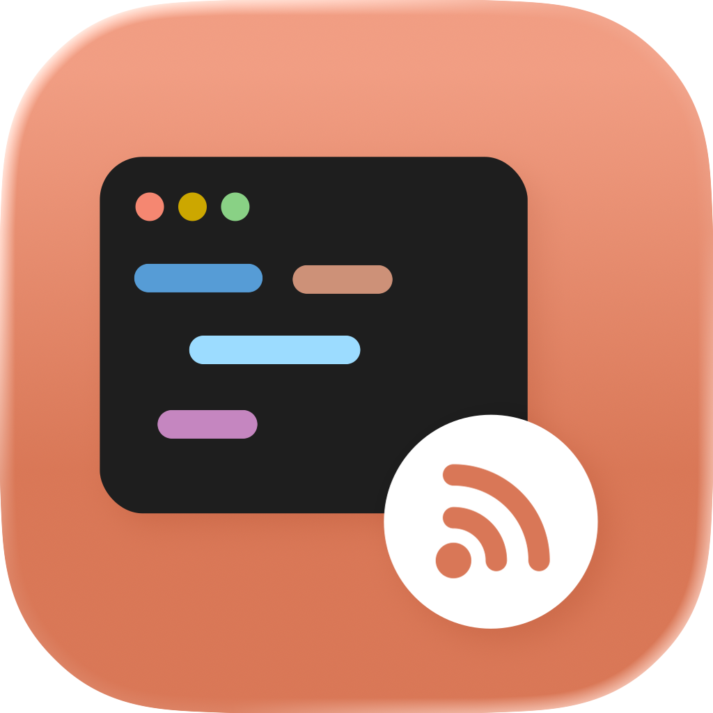

<p align="center">
  
</p>

<h1 align="center">Code Remote</h1>

<p align="center">
  <b>Your computer, in your pocket.</b><br>
  An iPhone app to browse files, use git and run a real terminal on your dev machine,
  over a secure Microsoft Dev Tunnel. No SSH, no port forwarding, no VPN.
</p>

<p align="center">
  <a href="https://coderemoteapp.github.io/web/"><b>Website</b></a> ·
  <a href="https://coderemoteapp.github.io/web/docs/"><b>Docs</b></a> ·
  <a href="https://www.npmjs.com/package/coderemote"><b>npm</b></a>
</p>

---

## Get started

On your computer:

```sh
npm install -g coderemote
cd ~/projects/my-app && coderemote up
```

On your iPhone: scan the QR code it prints. The iOS app is coming to the App Store.

## Features

- **Files:** browse, open, edit, create, rename and delete files in the shared folder
- **Git:** changes, diffs, stage, commit, pull, push and history across every repository in the folder
- **Terminal:** a real PTY shell with a key bar; sessions survive the phone sleeping, so `claude`, `vim` or a long build keep going
- **VS Code in the browser (optional):** `coderemote up --web` prints a vscode.dev link for the full editor
- **Private by default:** only your own GitHub or Microsoft account gets through the tunnel, plus a pairing token per device

## Repositories

| Repository | What |
|---|---|
| [coderemote](https://github.com/CodeRemoteApp/coderemote) | The open-source side: `coderemote` CLI, agent and wire protocol (AGPL-3.0) |
| [web](https://github.com/CodeRemoteApp/web) | Website, docs, privacy policy and support |
